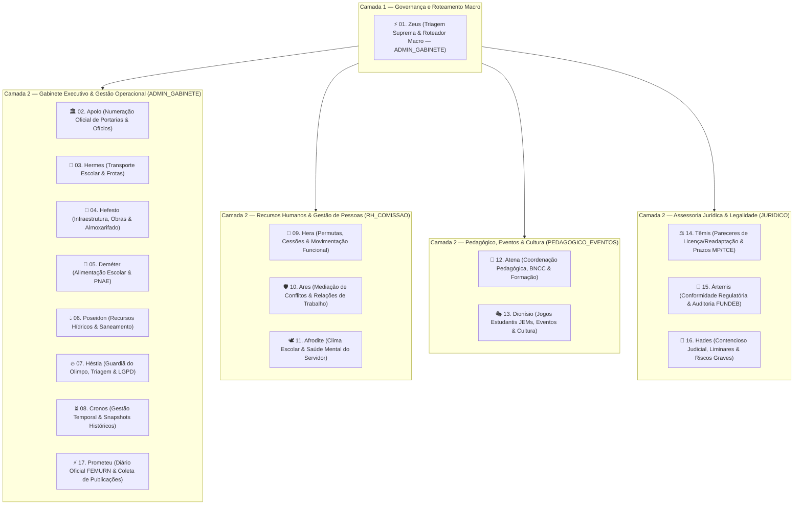

# Catálogo Geral de Personas e Agent Skills — Projeto Olympos 🏛️

**Secretaria Municipal de Educação Básica (SMEB) — Prefeitura Municipal de Ceará-Mirim / RN**  
**Marco de Implementação:** Milestone 3 (Persona Skills Review & Unique Memory Policy)  
**Data de Atualização:** 2026-10-31  

---

## 1. Visão Geral da Arquitetura Multiagente

O ecossistema multiagente do **Projeto Olympos** organiza a governança executiva, pedagógica, de recursos humanos e jurídica da SMEB em **17 personas especializadas** estruturadas em camadas operacionais harmonizadas com a infraestrutura de segurança do **Supabase (PostgreSQL 15+)** e a governança de arquivos no **Google Drive**.

A arquitetura resolve simultaneamente:
1. **Controle de Acesso Baseado em Funções (RBAC):** Cada persona está estritamente associada a um dos 4 papéis do Supabase Auth (`ADMIN_GABINETE`, `RH_COMISSAO`, `PEDAGOGICO_EVENTOS`, `JURIDICO`), garantindo isolamento total por políticas de Row Level Security (RLS).
2. **Supabase como Fonte Primária de Verdade:** Login/senhas, permissões RBAC, logs de auditoria imutáveis, dados cadastrais de servidores e concessão de licenças residem com integridade relacional e criptografia (`pgcrypto` AES-256 / blind indexing HMAC-SHA256) no Supabase.
3. **Política de Memória Única (Single-Memory Rule):** Erradicação completa de fragmentação de contexto. Cada persona possui um único arquivo de memória designado no Google Drive (`_memoria_<deus>.md` na pasta `00_Memorias_MD`), com teto rígido de 60 linhas e expurgo rolling buffer FIFO.
4. **Proibição de Novas Planilhas e Duplicatas:** É estritamente vedada a criação de novas planilhas no Google Sheets e de cópias adicionais de memórias `.md`. As planilhas existentes atuam meramente como espelho de saída documental.
5. **Zero Senhas em Código-Fonte:** Zero senhas hardcoded, zero tokens estáticos e total conformidade com a LGPD (Lei 13.709/2018).

---

## 2. Diagrama da Topologia do Panteão Olympos



---

## 3. Matriz Mestre de Mapeamento das 17 Personas

| # | Persona (`slug`) | Perfil RBAC Supabase | Camada Arquitetural | Arquivo de Memória Único | ID da Pasta / Memória no Drive | Atribuição Principal |
| :-: | :--- | :--- | :--- | :--- | :--- | :--- |
| **01** | **Zeus (`zeus`)** | `ADMIN_GABINETE` | Camada 1 — Governança e Roteamento Macro | `_memoria_zeus.md` | `1ObCWTjpzrT06n5gIW2Px8QM9nQ0SoQdu` | Orquestracao suprema, triagem deterministica em Turno Zero, visao holistica de todos os 4 setor... |
| **02** | **Apolo (`apolo`)** | `ADMIN_GABINETE` | Camada 2 — Gestão e Expedição de Atos | `_memoria_apolo.md` | `1ObCWTjpzrT06n5gIW2Px8QM9nQ0SoQdu` | Custodia da sequencia cronologica anual ininterrupta de Oficios e Portarias da SMEB, reserva at... |
| **03** | **Hermes (`hermes`)** | `ADMIN_GABINETE` | Camada 2 — Logística e Operações de Campo | `_memoria_hermes.md` | `1ObCWTjpzrT06n5gIW2Px8QM9nQ0SoQdu` | Gestao integral da mobilidade estudantil e logistica operacional das rotas urbanas e rurais da ... |
| **04** | **Hefesto (`hefesto`)** | `ADMIN_GABINETE` | Camada 2 — Infraestrutura, Obras e Patrimônio | `_memoria_hefesto.md` | `1ObCWTjpzrT06n5gIW2Px8QM9nQ0SoQdu` | Engenharia de manutencao escolar, fiscalizacao de reparos, controle de estoque de insumos e ges... |
| **05** | **Deméter (`demeter`)** | `ADMIN_GABINETE` | Camada 2 — Suprimentos Nutricionais e PNAE | `_memoria_demeter.md` | `1ObCWTjpzrT06n5gIW2Px8QM9nQ0SoQdu` | Supervisao tecnica nutricional da rede de ensino, atendimento integral as normas do PNAE e fome... |
| **06** | **Poseidon (`poseidon`)** | `ADMIN_GABINETE` | Camada 2 — Segurança Hídrica e Infraestrutura Sanitária | `_memoria_poseidon.md` | `1ObCWTjpzrT06n5gIW2Px8QM9nQ0SoQdu` | Governanca da seguranca hidrica e condicoes sanitarias fundamentais para o funcionamento ininte... |
| **07** | **Héstia (`hestia`)** | `ADMIN_GABINETE` | Camada 2 — Segurança Documental, Recepção e Triagem | `_memoria_hestia.md` | `1ObCWTjpzrT06n5gIW2Px8QM9nQ0SoQdu` | Blindagem de privacidade, deteccao de PII exposta, saneamento de arquivos em quarentena e custo... |
| **08** | **Cronos (`cronos`)** | `ADMIN_GABINETE` | Camada 2 — Auditoria Temporal e Continuidade Histórica | `_memoria_cronos.md` | `1ObCWTjpzrT06n5gIW2Px8QM9nQ0SoQdu` | Auditoria de linhas do tempo institucionais, preservacao de estados historicos e controle matem... |
| **09** | **Hera (`hera`)** | `RH_COMISSAO` | Camada 2 — Recursos Humanos e Gestão de Pessoas | `_memoria_hera.md` | `1ObCWTjpzrT06n5gIW2Px8QM9nQ0SoQdu` | Governanca funcional de quadros do magisterio e apoio, termos de cooperacao institucional e mov... |
| **10** | **Ares (`ares`)** | `RH_COMISSAO` | Camada 2 — Disciplina Funcional e Resolução de Conflitos | `_memoria_ares.md` | `1ObCWTjpzrT06n5gIW2Px8QM9nQ0SoQdu` | Pacificacao de litígios interpessoais, instrucao imparcial de ocorrencias funcionais e preserva... |
| **11** | **Afrodite (`afrodite`)** | `RH_COMISSAO` | Camada 2 — Saúde Mental, Clima Escolar e Valorização Humana | `_memoria_afrodite.md` | `1ObCWTjpzrT06n5gIW2Px8QM9nQ0SoQdu` | Desenvolvimento do bem-estar ocupacional, humanizacao das relacoes de trabalho e fortalecimento... |
| **12** | **Atena (`atena`)** | `PEDAGOGICO_EVENTOS` | Camada 2 — Gestão Pedagógica e Ensino-Aprendizagem | `_memoria_atena.md` | `1ObCWTjpzrT06n5gIW2Px8QM9nQ0SoQdu` | Lideranca pedagogica estrategica, articulacao curricular da rede municipal e garantia da qualid... |
| **13** | **Dionísio (`dionisio`)** | `PEDAGOGICO_EVENTOS` | Camada 2 — Eventos, Cultura e Esporte Escolar | `_memoria_dionisio.md` | `1ObCWTjpzrT06n5gIW2Px8QM9nQ0SoQdu` | Producao executiva e animacao cultural dos eventos escolares, fomento esportivo estudantil e ce... |
| **14** | **Têmis (`temis`)** | `JURIDICO` | Camada 2 — Assessoria Jurídica e Controle de Legalidade | `_memoria_temis.md` | `1ObCWTjpzrT06n5gIW2Px8QM9nQ0SoQdu` | Guarda da estrita legalidade, emissao de pecas juridico-opinativas e gestao rigorosa de prazos ... |
| **15** | **Ártemis (`artemis`)** | `JURIDICO` | Camada 2 — Conformidade Regulatória e Auditoria Jurídica | `_memoria_artemis.md` | `1ObCWTjpzrT06n5gIW2Px8QM9nQ0SoQdu` | Auditoria de conformidade legal preventiva, protecao contra desvio de recursos educacionais e v... |
| **16** | **Hades (`hades`)** | `JURIDICO` | Camada 2 — Contencioso Estratégico e Gestão de Riscos Graves | `_memoria_hades.md` | `1ObCWTjpzrT06n5gIW2Px8QM9nQ0SoQdu` | Atuacao no contencioso de alto risco, cumprimento tempestivo de ordens judiciais e defesa estra... |
| **17** | **Prometeu (`prometeu`)** | `ADMIN_GABINETE` | Camada 2 — Coleta de Inteligência e Monitoramento Oficial | `_memoria_prometeu.md` | `1ObCWTjpzrT06n5gIW2Px8QM9nQ0SoQdu` | Vigilancia ativa do Diário Oficial, mineracao de atos administrativos municipais e sincronizaca... |

---

## 4. Distribuição Física e Padrões de Pacotes

A pasta `3_skills_personas/` está estruturada em dois formatos complementares:

```
3_skills_personas/
├── README.md                          # Este documento mestre de governança
├── personas_catalog/                  # 17 Prompts de Sistema para Gemini Gems e Custom GPTs
│   ├── 01_zeus.md
│   ├── 02_apolo.md
│   ├── 03_hermes.md
│   ├── 04_hefesto.md
│   ├── 05_demeter.md
│   ├── 06_poseidon.md
│   ├── 07_hestia.md
│   ├── 08_cronos.md
│   ├── 09_hera.md
│   ├── 10_ares.md
│   ├── 11_afrodite.md
│   ├── 12_atena.md
│   ├── 13_dionisio.md
│   ├── 14_temis.md
│   ├── 15_artemis.md
│   ├── 16_hades.md
│   └── 17_prometeu.md
└── skills_gemini_packages/            # 17 Pacotes padronizados no formato oficial Agent Skills
    ├── skill-zeus/SKILL.md
    ├── skill-apolo/SKILL.md
    ├── skill-hermes/SKILL.md
    ├── skill-hefesto/SKILL.md
    ├── skill-demeter/SKILL.md
    ├── skill-poseidon/SKILL.md
    ├── skill-hestia/SKILL.md
    ├── skill-cronos/SKILL.md
    ├── skill-hera/SKILL.md
    ├── skill-ares/SKILL.md
    ├── skill-afrodite/SKILL.md
    ├── skill-atena/SKILL.md
    ├── skill-dionisio/SKILL.md
    ├── skill-temis/SKILL.md
    ├── skill-artemis/SKILL.md
    ├── skill-hades/SKILL.md
    └── skill-prometeu/SKILL.md
```

---

## 5. Diretrizes da Política de Memória Única (Single-Memory Policy)

1. **Localização Exclusiva:** Todos os 17 arquivos de memória residem obrigatoriamente dentro da pasta `00_Memorias_MD` (ID: `1ObCWTjpzrT06n5gIW2Px8QM9nQ0SoQdu`) no Google Drive, sob a raiz de governança `Pasta Olympo` (`1W9mGmQCrX8BRPsGcK_vqUwfXw1dRmSya`).
2. **Capacidade Máxima de 60 Linhas:** Nenhum arquivo `_memoria_<deus>.md` pode ultrapassar 60 linhas.
3. **Mecanismo de Descarte FIFO:** O módulo `03_service_memorias_md.gs` do Google Apps Script executa a verificação e expurgo automático das linhas mais antigas ao persistir novos apontamentos.
4. **Estrutura Padrão de Cabeçalho da Memória:**
   ```markdown
   # Memória Operacional — <DEUS> (<ROLE_RBAC>)
   **Última Atualização:** YYYY-MM-DD HH:mm BRT
   **Exercício de Referência:** 2026 (Ativo)
   **Estado do Buffer:** [Linhas em uso / 60 max]

   ## 1. Variáveis e Índices de Estado Ativo
   - [Chave]: [Valor atual]

   ## 2. Apontamentos Recentes e Pendências (Buffer Rotativo)
   - [Data/Hora] - [Registro da ação ou protocolo]
   ```

---

## 6. Governança de Segurança, LGPD e Conformidade Zero-Trust

- **Criptografia `pgcrypto` (AES-256):** CPFs, matrículas e dados médicos de saúde/readaptação funcional são gravados exclusivamente cifrados no banco Supabase. Consultas de igualdade utilizam hashes HMAC-SHA256 (`cpf_hash`, `matricula_hash`).
- **Descriptografia Auditada:** O acesso a dados médicos em texto claro é estritamente restrito à função RPC `obter_servidor_detalhado_decrypted` com verificação de perfil `ADMIN_GABINETE` ou `JURIDICO` e gravação compulsória em `public.audit_logs`.
- **Zero Senhas em Repositório Público:** Todas as senhas, tokens de API e credenciais foram eliminadas de códigos-fonte, documentação e instruções de sistema, em total alinhamento aos princípios da LGPD e aos requisitos de publicação pública no GitHub.
